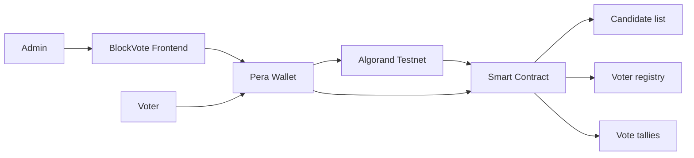
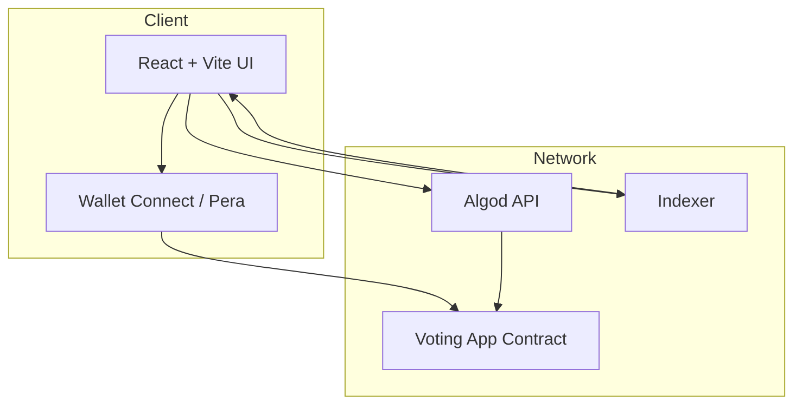
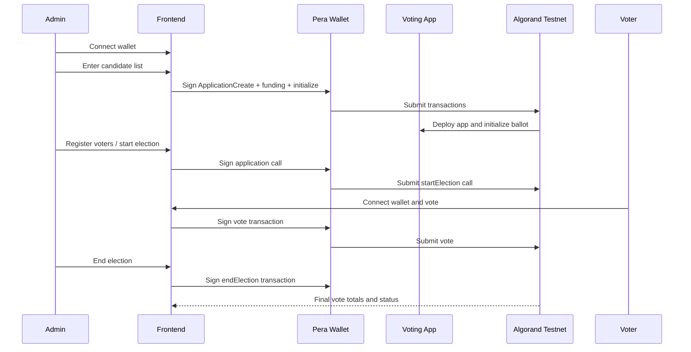

# BlockVote — Transparent voting on Algorand

<p align="center">
  
  
  
  
</p>

BlockVote is a blockchain-powered voting prototype built on Algorand. It combines a modern React interface with an on-chain smart contract to create a transparent, auditable ballot system that can be deployed to Algorand Testnet with a wallet like Pera.

The application allows an admin to create an election, register eligible voters, start/stop the contest, and let users cast votes directly from the wallet. Every state transition is stored on-chain, making the election trail visible and verifiable.

## Why this project matters

- Transparent voting flow with on-chain state
- No centralized backend required for ballot logic
- Testnet-first deployment for experimentation and education
- Friendly frontend for demoing a blockchain election experience
- Smart contract logic designed around a simple democratic voting lifecycle

## Product snapshot



## System architecture



## Project tree

```text
BlockVote/
├── README.md                    # Product overview and setup guide
├── DEMO.md                      # Demo notes and usage walkthrough
├── frontend/                    # Vite + React election UI
│   ├── src/
│   │   ├── App.jsx              # Ballot and election controls
│   │   ├── deploy.jsx           # Deploy-on-testnet flow
│   │   ├── algorand.js          # Pera & Algorand helpers
│   │   ├── config.js            # Network and app config
│   │   └── style.css            # App styling
│   ├── package.json
│   ├── index.html
│   ├── deploy.html
│   └── vite.config.js
├── blockchain/                  # Algorand smart contract project
│   ├── src/
│   │   ├── voting.algo.ts       # Voting smart contract logic
│   │   └── voting.algo.spec.ts # Contract test cases
│   ├── artifacts/
│   ├── package.json
│   ├── tsconfig.json
│   ├── deploy.ts
│   ├── localnet.ts
│   ├── index.ts
│   └── .gitignore
└── .gitignore
```

## Core features

- Admin-driven ballot setup
- Candidate registration on chain
- Voter registration and eligibility checks
- Start election and end election transitions
- Single-vote enforcement per connected wallet
- Live election state fetch via Algorand API and Indexer
- Testnet-first deployment with Pera Wallet signing

## Vote lifecycle



## Tech stack

| Layer | Stack |
|---|---|
| Frontend | React, Vite, JavaScript |
| Wallet | Pera Wallet |
| Blockchain | Algorand, Algod, Indexer |
| Smart contract | Algorand TypeScript / Puya-style contract logic |
| Deployment | Testnet transaction flow via Web3 wallet signing |

## Local setup

### 1) Install project dependencies

```bash
cd blockchain
npm install

cd ../frontend
npm install
```

### 2) Run the frontend locally

```bash
cd frontend
npm run dev
```

The UI is served on `http://localhost:5173`.

### 3) Deploy to Algorand Testnet

This project is designed for Algorand Testnet. Use a funded Pera Wallet account and follow the deploy flow in the frontend UI.

The app uses public endpoints:

- Algod: `https://testnet-api.algonode.cloud`
- Indexer: `https://testnet-idx.algonode.cloud`
- Chain ID: `416002`

## Smart contract behavior

The voting app keeps state in a few global keys and box-based storage entries:

- `admin` — election owner / authority wallet
- `started` — whether voting is live
- `ended` — whether the election has been sealed
- `count` — number of candidates
- `candidates` — per-candidate name and vote total
- `voters` — registered and already-voted per wallet

This gives a straightforward, transparent election contract without introducing a custom backend layer.

## Deployment flow

1. Connect a funded Pera Wallet on Algorand Testnet.
2. Enter the candidate names in the deployment form.
3. The app creates the application, funds the contract escrow, and initializes ballot data.
4. Use the generated app ID in the frontend to load the live election state.
5. Register voting addresses, open the election, and let voters cast ballots.

## Example app state

The current frontend configuration references a live app ID in `frontend/src/config.js`:

```js
export const VOTING_APP_ID = 775965069n;
```

This value can be replaced with any newly deployed testnet app ID.

## Notes and limitations

This is a learning-first prototype and not a production-grade election system.

- Vote data is public on-chain
- Voter identity is wallet-based, not KYC-verified
- No anonymity layer, coercion resistance, or advanced auditing suite yet
- Best suited for demos, learning, and testnet validation

## Roadmap ideas

- Add voter registration dashboard and admin controls
- Show live results in charts and rankings
- Improve UX for wallet connection and transaction feedback
- Add more robust validation and governance rules
- Expand to full mainnet-ready deployment patterns

## License

This project is intended for educational and demo purposes. Update the license if you plan to distribute it publicly.

## Quick command reference

```bash
# Blockchain
cd blockchain
npm install
npm run build
npm run test
npm run deploy:testnet

# Frontend
cd frontend
npm install
npm run dev
npm run build
```
