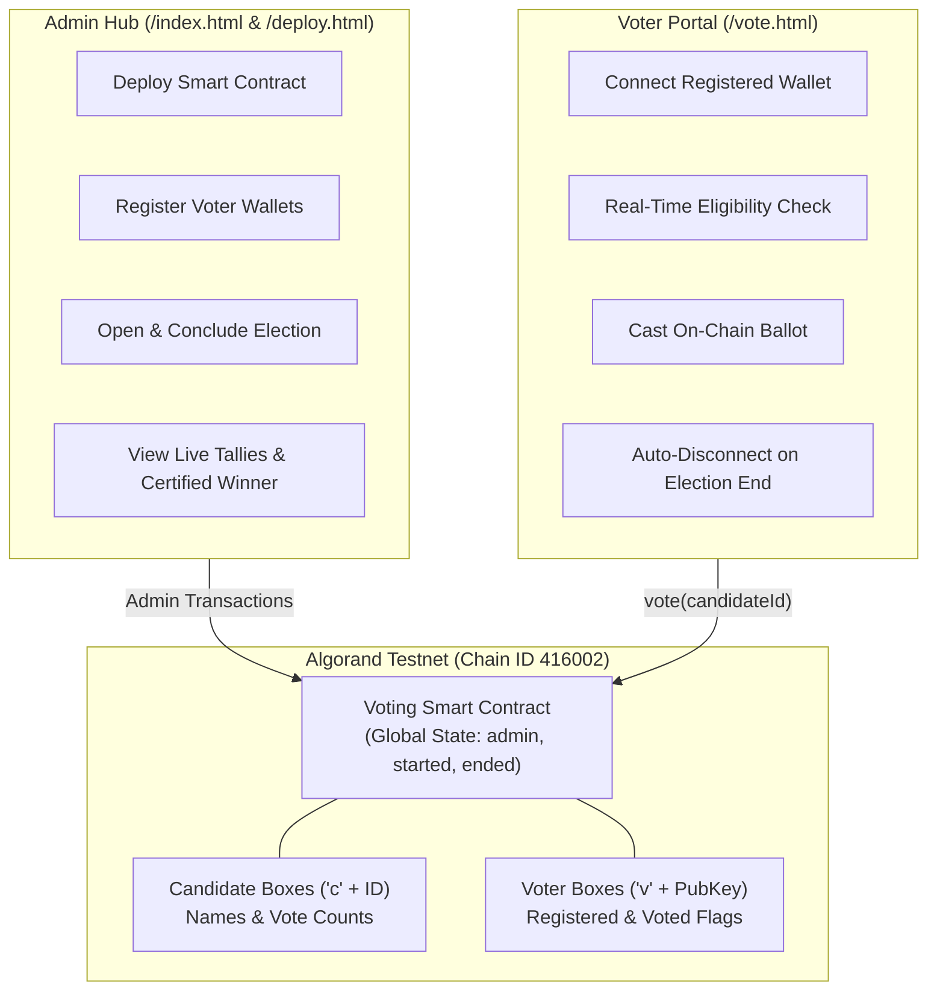
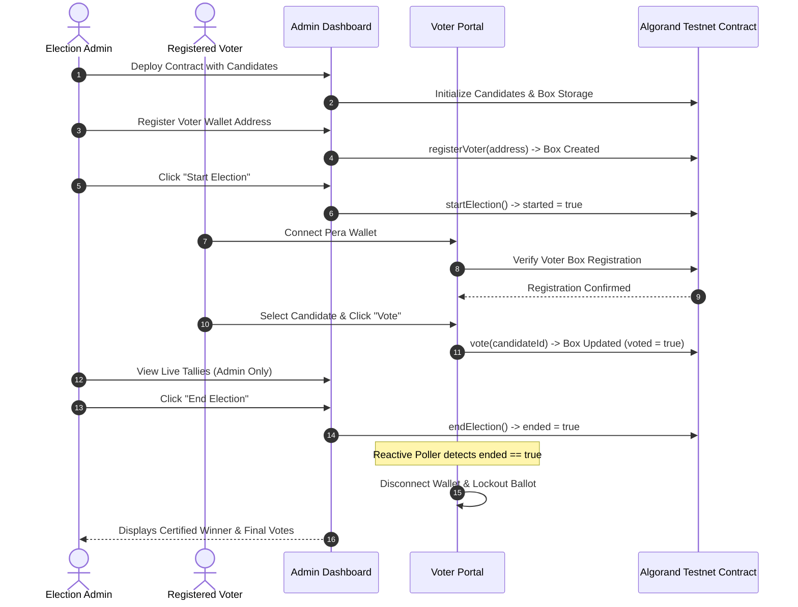

# BlockVote — Transparent Voting on Algorand

<p align="center">
  
  
  
  
</p>

BlockVote is a decentralized voting dApp built on the Algorand blockchain. It connects a high-performance React frontend with an on-chain smart contract, ensuring every ballot, voter registration, and election transition is cryptographically verifiable, auditable, and immutable on Algorand Testnet.

---

## Architecture: Dedicated Admin & Voter Surfaces

To prevent administrative confusion, maintain election integrity, and provide a distraction-free experience, BlockVote separates the application into dedicated multi-page surfaces powered by a shared smart contract:



### Application Surfaces

1. **Voter Portal (`/vote.html`)**:
   - Clean, focused ballot interface designed exclusively for voters.
   - **Strict Access Control**: Prohibits admin wallet connections; only allows wallets registered on-chain by the administrator to connect.
   - **Ballot Confidentiality**: Vote tallies, live counts, and percentage bars are completely hidden from voters to prevent bandwagoning or premature outcome bias.
   - **Auto-Disconnect & Lockout**: A real-time on-chain watcher detects the moment the admin ends the election, automatically disconnecting voter wallets and permanently sealing the ballot.

2. **Admin Dashboard (`/index.html`)**:
   - Full election lifecycle cockpit for the administrator.
   - Register voter wallet addresses into contract box storage before polls open.
   - Start and permanently seal elections.
   - Real-time tally breakdown, percentage progress bars, total vote metrics, and certified winner announcements.

3. **Deploy Tool (`/deploy.html`)**:
   - 4-step deployment wizard that compiles and creates the contract on Testnet, funds the application box storage escrow, initializes ballot candidates, and configures the election.

---

## Key Features & Security Model

- **Decentralized State Machine**: All election states (`not started` → `started` → `ended`) are stored on-chain in contract global state.
- **Box-Storage Architecture**: 
  - Candidates: Stored under key prefix `0x63` (`c`) + candidate uint64 ID.
  - Voters: Stored under key prefix `0x76` (`v`) + voter 32-byte public key storing `(bool registered, bool voted)`.
- **Double-Voting Prevention**: Smart contract guarantees each registered wallet can submit exactly one ballot per election.
- **Role-Based Surface Gating**: The voting portal actively rejects the administrator wallet, ensuring separation of duties.
- **Zero Backend Dependencies**: Pure Web3 client interacting directly with Algorand node (`algod`) and Indexer endpoints via `@perawallet/connect` and `algosdk`.

---

## Project Structure

```text
BlockVote/
├── docs/
│   └── superpowers/plans/       # Implementation plans & architecture specs
├── frontend/                    # Multi-page React 18 + Vite 5 frontend
│   ├── src/
│   │   ├── VoterApp.jsx         # Standalone voter portal component
│   │   ├── App.jsx              # Admin dashboard & election hub
│   │   ├── deploy.jsx           # Contract deployment wizard
│   │   ├── vote.jsx             # Voter portal mount point
│   │   ├── main.jsx             # Admin hub mount point
│   │   ├── algorand.js          # Algorand SDK & Pera Wallet helpers
│   │   ├── config.js            # Network endpoints & App ID config
│   │   └── style.css            # Unified production stylesheet (Impeccable craft)
│   ├── index.html               # Admin Dashboard entry point
│   ├── vote.html                # Voter Portal entry point
│   ├── deploy.html              # Deploy Tool entry point
│   ├── package.json
│   └── vite.config.js           # Multi-page Rollup input configuration
├── blockchain/                  # Algorand smart contracts
│   ├── src/
│   │   ├── voting.algo.ts       # Algorand TypeScript contract implementation
│   │   └── voting.algo.spec.ts  # Vitest contract unit tests (8 passing)
│   ├── artifacts/               # Generated ARC-56 client & TEAL bytecode
│   ├── deploy.ts                # Node deployment script
│   └── package.json
└── README.md
```

---

## Recent Improvements & Changelog

### 1. Dedicated Standalone Voter Portal
- Segregated voter functionality into `vote.html` / `VoterApp.jsx`, removing all admin buttons, deployment options, and management panels from the voter view.
- Configured Vite multi-page Rollup inputs (`index.html`, `deploy.html`, `vote.html`) for clean asset chunking and independent routing.

### 2. Strict Role Gating on Voting Portal
- **Admin Blocking**: The voter portal checks the connected address against the smart contract's `admin` state. If the admin connects, connection is refused with an alert prompting to switch to a voter wallet.
- **Unregistered Wallet Blocking**: Non-registered wallets are prevented from connecting or viewing active ballot controls, accompanied by a quick "Copy Address" tool to send to the administrator.
- **Auto-Filtering**: Automatically filters out the administrator's address when switching accounts in multi-account Pera Wallet sessions.

### 3. Tally & Result Confidentiality
- Candidate cards on the voter page only display candidate names and voting buttons (no vote counts or rankings).
- Removed the live tally progress section from the voter portal; all vote analytics and certified results remain exclusively on the Admin Hub.

### 4. Automatic Session Disconnection on Election Close
- Added a 2.5-second reactive polling watcher to `VoterApp.jsx`.
- When the admin ends the election, voter wallets are automatically disconnected in real time, and all further ballot submissions are permanently locked out.

### 5. Impeccable CSS & UI Craftsmanship
- Overhauled `style.css` using tactile, production-ready design tokens.
- Implemented responsive concentric border radii, smooth hover lifts, active button presses (`scale(0.98)`), and minimum 40px hit areas.
- Standardized `background-clip: text` vendor compatibility, antialiased font smoothing, and tabular numerals (`font-variant-numeric: tabular-nums`) to prevent number layout shift.

---

## Local Development & Setup

### Prerequisites
- Node.js >= 20.0
- Pera Wallet mobile app (configured on **Testnet**) with Testnet ALGO from the [Algorand Testnet Dispenser](https://bank.testnet.algorand.network/).

### 1. Smart Contract (Blockchain)

```bash
cd blockchain
npm install

# Run contract unit tests
npx vitest run

# Build TEAL artifacts & ARC-56 client
npm run build
```

### 2. Frontend Application

```bash
cd frontend
npm install

# Start Vite development server
npm run dev
```

Open your browser to:
- **Voter Portal:** `http://localhost:5173/vote.html`
- **Admin Dashboard:** `http://localhost:5173/` or `/index.html`
- **Deploy Election:** `http://localhost:5173/deploy.html`

### 3. Production Build

```bash
cd frontend
npm run build
```

The output bundles will be cleanly emitted to `frontend/dist/` with separate HTML and JS assets for `index.html`, `deploy.html`, and `vote.html`.

---

## Election Workflow Walkthrough



---

## License

Educational and prototyping project built on Algorand Testnet.
Built by Anurag Naskar , Saumya Biswas , Swastik Nayak , Soumyadip Satpati

## Quick command reference

```bash
# Blockchain
cd blockchain
npm install
npm run build
npm run test
npm run deploy:testnet

# Frontend
cd frontend
npm install
npm run dev
npm run build
```
